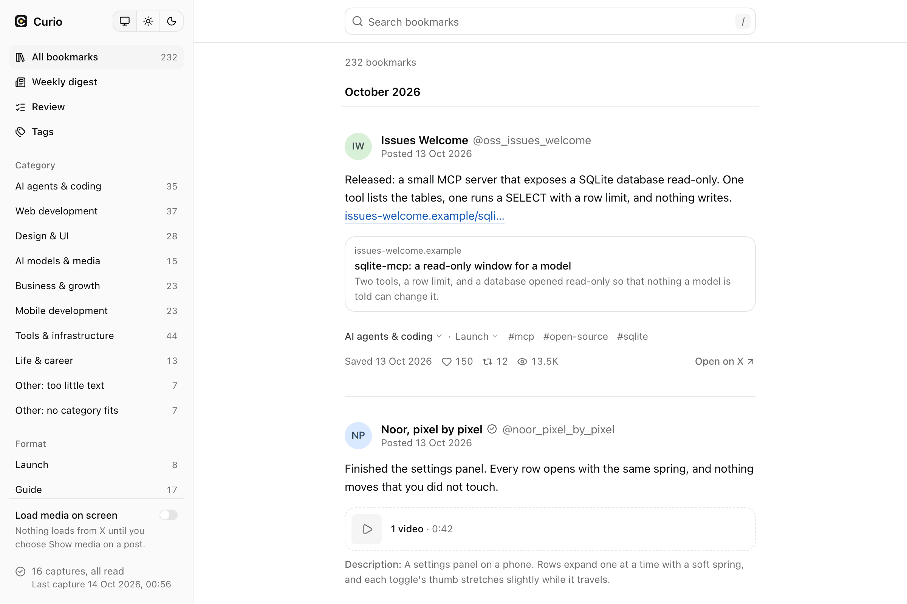
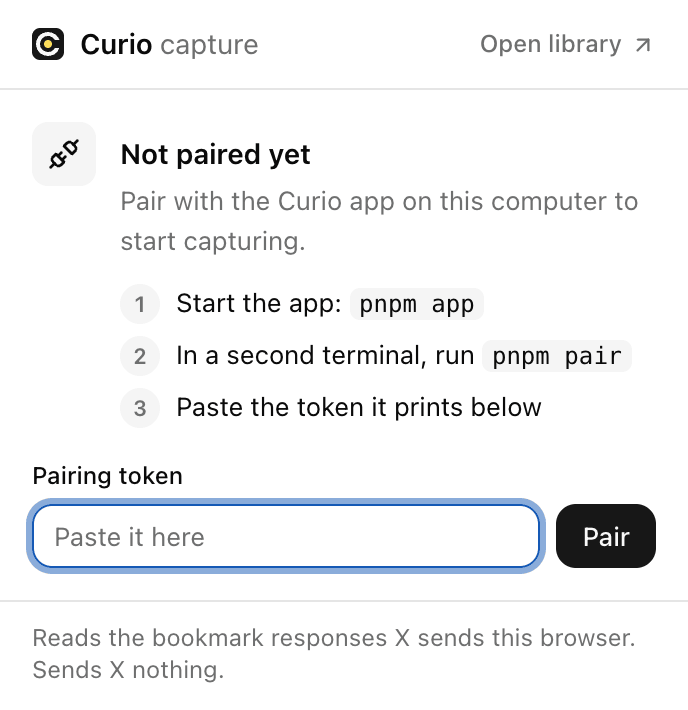
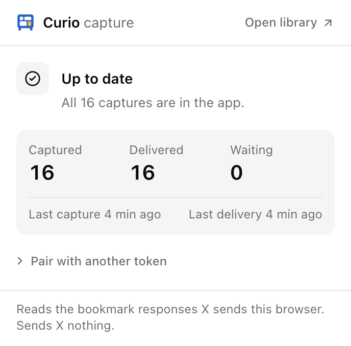
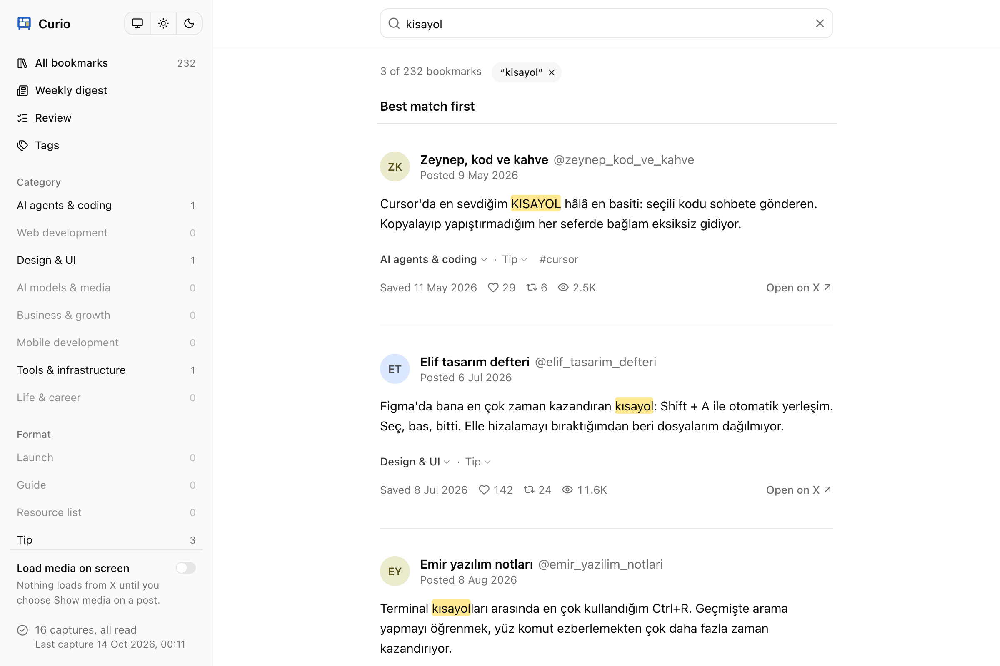
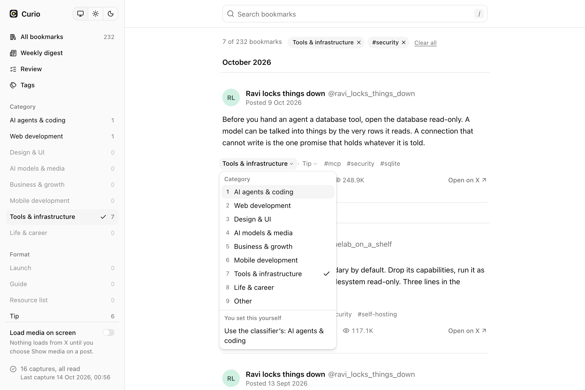
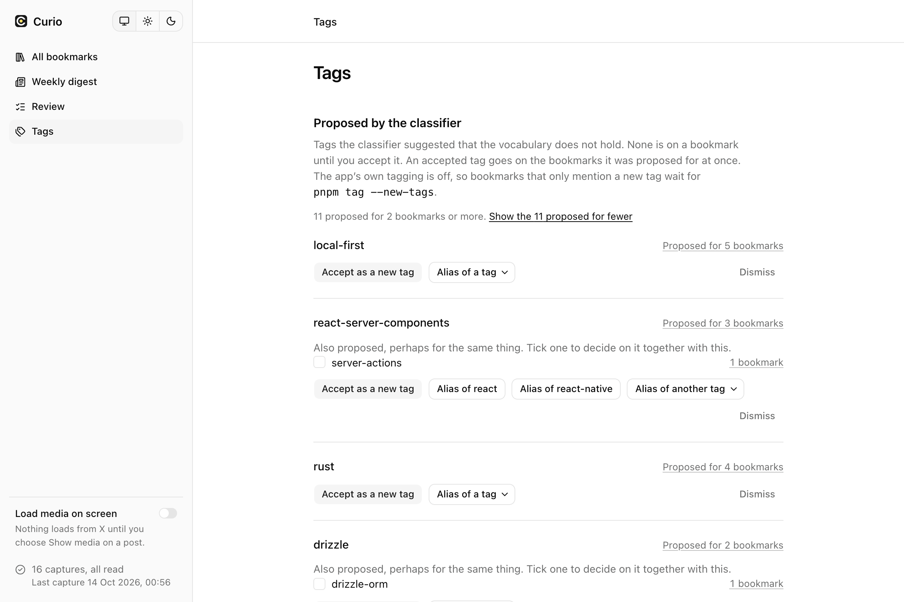
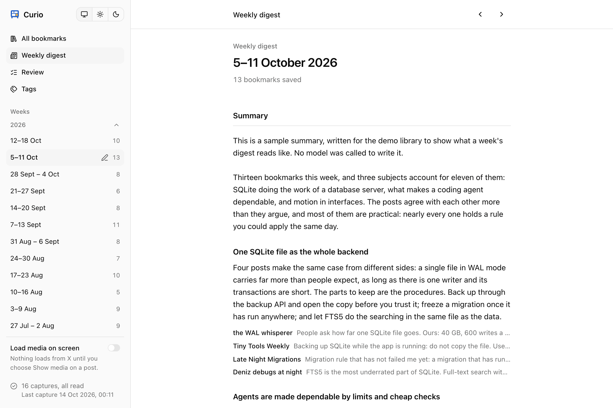

<h1>&nbsp;Curio</h1>

Your X bookmarks, kept in one SQLite file on your own computer: searchable, filed, summarised each week, and readable by Claude.

<picture>
  <source media="(prefers-color-scheme: dark)" srcset="docs/screenshots/library-dark.png">
  
</picture>

X shows your bookmarks as one long list. Curio copies them as you browse, with a small Chrome extension that reads what the bookmarks page was already sent and asks X for nothing, and keeps them in a local app where they can be searched, filtered and filed. It is for one person and their own account: a developer who bookmarks more than they reread, and would rather own the list than rent a view of it.

Every post in the screenshots is invented. They are taken from the demo library, which you can run before capturing anything of your own: [the demo](#the-demo).

## What it does

**Captures without the API.** The extension keeps a copy of the bookmark responses X's web client receives, and hands them to the app. Scroll your bookmarks once to the bottom and the whole list is in; after that, opening the page now and then keeps it current. There is no API fee, and none of the official API's 800-post limit.

<p>
  <picture>
    <source media="(prefers-color-scheme: dark)" srcset="docs/screenshots/popup-not-paired-dark.png">
    
  </picture>
  <picture>
    <source media="(prefers-color-scheme: dark)" srcset="docs/screenshots/popup-paired-dark.png">
    
  </picture>
</p>

**Search that finds it.** Full-text search over the post, its author, the post it quotes, the descriptions of its pictures and the titles of its link card and article, best match first. Case and accents make no difference, and neither does the Turkish dotless ı: below, `kisayol` typed on a keyboard without one finds `KISAYOL`, `kısayol` and `kısayolları`.

<picture>
  <source media="(prefers-color-scheme: dark)" srcset="docs/screenshots/search-dark.png">
  
</picture>

**Filed, and yours to refile.** Each bookmark sits under one category, one format and a few tags. A classifier can file them for you by asking Claude (optional, [below](#tagging-and-the-weekly-digest-optional)), and anything you change is kept apart from its answer, so no later run undoes it. Filters compose with search and with each other, and each shows how many bookmarks it would leave. The keyboard does all of it: `J` and `K` move, `C`, `R` and `T` open the category, the format and the tags.

<picture>
  <source media="(prefers-color-scheme: dark)" srcset="docs/screenshots/labels-dark.png">
  
</picture>

**A vocabulary you decide.** The classifier may suggest a tag you do not have. A suggestion is on no bookmark until you accept it, as a new tag or as another way of writing one you have; names that look alike are grouped for you and merged only if you say so. Tags can be added, renamed, merged and retired from the same page, and the bookmarks follow.

<picture>
  <source media="(prefers-color-scheme: dark)" srcset="docs/screenshots/tags-dark.png">
  
</picture>

**A page for each week.** What you saved, how it is filed, the posts themselves, and what the week suggests about your categories. When you ask for it, Claude writes a summary of the week: its themes, and which posts are worth going back to.

<picture>
  <source media="(prefers-color-scheme: dark)" srcset="docs/screenshots/digest-dark.png">
  
</picture>

Also:

- **Claude can read it.** A local, read-only [MCP server](#asking-claude) lets Claude Code and Claude Desktop search and list your bookmarks.
- **Nothing is lost when X changes.** Every response is stored exactly as it arrived before anything is parsed from it, so when X changes a response the parser is fixed and run again over what was kept. The status page says when that has happened.
- **What X drops, Curio keeps.** A bookmark you remove on X stays in the library, marked. So does one whose post was deleted or whose author went private: the copy captured earlier is the one you still have.
- **Media loads only when you ask.** Photos and videos are on X's servers, so a post shows what is attached and its description until you press Show media on it.
- **Backups by itself.** A verified snapshot of the whole database once a day, outside the repository.

## How it works

<picture>
  <source media="(prefers-color-scheme: dark)" srcset="docs/architecture/architecture-dark.png">
  
</picture>

The extension wraps the page's own `fetch` and `XMLHttpRequest` on x.com and, for five bookmark operations, keeps a copy of the response. It starts no request, changes none, and never scrolls or clicks. Its service worker signs each copy with a token you paste in once and delivers it to the app, which listens on this computer only.

The app stores the response as it arrived, parses it into bookmarks, and serves the screens above. One package, `packages/core`, is the only code that opens the database. Everything else, the screens, the MCP server and the tagger, reads the library through its query functions.

Two things can leave the boundary, and both wait for you. The tagger sends post text to the Claude API when you run it. Claude, when you ask it about your bookmarks, reads them through the MCP server, and what it reads is part of your conversation with it. [What you are trusting](#what-you-are-trusting-and-risking) has both in full.

The source of the diagram is [`docs/architecture/architecture.html`](docs/architecture/architecture.html); `pnpm diagram` exports it again.

## Install

You need:

- macOS. Nothing but the optional weekly schedule is tied to it, but Linux and Windows have not been tried.
- Node.js 24.12 or later, and pnpm 12 (`npm install --global pnpm@12`).
- Chrome 130 or later, on the same computer.

```
git clone https://github.com/emretfn/curio.git
cd curio
pnpm install
```

1. **Start the app: `pnpm app`.** It builds, which takes about a minute the first time, and then serves <http://127.0.0.1:47130>. Leave it running. The library is empty and says how it fills.
2. **Build the extension:** in a second terminal, in the same folder, `pnpm extension:build`.
3. **Load it.** In Chrome open `chrome://extensions`, switch on **Developer mode**, press **Load unpacked** and choose the folder `packages/extension/dist`. Chrome lists it as "Curio capture". Pin its icon, an open C holding a yellow dot on a dark tile, to the toolbar.
4. **Pair.** In a second terminal, run `pnpm pair`. Click the extension's icon and paste the token it prints into the popup, then press **Pair**. The popup reads "Paired. Nothing captured yet".
5. **Capture.** Open your bookmarks on x.com, reloading the tab if it was open before the extension was loaded, and scroll to the bottom by hand at the pace you would read. X loads 20 bookmarks at a step and the popup counts each one; 3,000 bookmarks is about a quarter of an hour.
6. **Look.** <http://127.0.0.1:47130> lists them, and <http://127.0.0.1:47130/status> says how many responses were stored and understood. "Captures failed" and "Entries failed" should read 0.

After that, open the bookmarks page now and then: new bookmarks are at the top, so one page load picks them up. If the app is closed while you browse, the extension keeps what it captured and delivers it when the app is back.

[The extension's README](packages/extension/README.md) has every state of the popup and what to do when a count does not move. [The app's README](packages/web/README.md) has the screens, the status page and what to do when X changes a response.

## The demo

```
pnpm demo
```

builds a library of about 230 invented posts by invented authors and starts the app on it at <http://127.0.0.1:47131>. It needs no extension, no pairing, no key and no network, and it runs beside the real app without touching it: its library is in `demo-data/`, and is made again each time. Everything on the screens above can be tried in it, corrections and tag merges included.

Demo posts with media show what is attached and its description, and no pictures: the posts do not exist on X, so there is nothing to load. [The demo's README](packages/demo/README.md) says what is in it and how it is made.

## Tagging and the weekly digest (optional)

Capture, search, the filters by author, language, media and date, the weekly page, backups and the MCP server need no account anywhere. Two things need an Anthropic API key of your own, and cost money each time they run:

| | What it does | What it costs |
|---|---|---|
| `pnpm tag` | Files each unclassified bookmark under a category, a format and tags | About $0.00012 a bookmark as first measured (50 bookmarks for $0.0061): under twenty cents for a library of 1,400, and a cent or so a week after that |
| `pnpm digest` | Writes the summary of one week | One request a week. Estimated at $0.03 to $0.16 for weeks of 9 to 37 bookmarks; none had been written when that was estimated |

Each run has a spend cap it cannot exceed ($2 for a tagging run and $0.50 for a digest unless you say otherwise), and both have a dry run that sends nothing and needs no key:

```
cp .env.example .env && chmod 600 .env    # then paste your key after CURIO_ANTHROPIC_API_KEY=
pnpm tag --dry-run        # what a run would send and cost
pnpm tag --sample 50      # classify 50, and read whether you agree
pnpm tag                  # classify the rest
pnpm digest --dry-run
pnpm digest               # write the week that last ended
```

The key's variable is named for this project on purpose. Do not call it `ANTHROPIC_API_KEY`: under that name a key silently bills your Claude Code work to the API wherever it is set.

Nothing spends by itself. Every run above is one you typed. The app can keep up with new bookmarks on its own, at most $0.10 a pass and $0.30 a day, only if you add the line `CURIO_APP_TAGGING=on` to `.env` by hand; no screen can turn that on. A digest can be scheduled weekly with a launchd job that you install yourself.

Without a key you can still file bookmarks by hand, from the same menus. [The tagger's README](packages/tagger/README.md) has the commands in order, exactly what is sent, and what a run guarantees.

## Asking Claude

`packages/mcp` is a local [MCP](https://modelcontextprotocol.io) server over standard input and output. It opens the database read-only, makes no network request, and runs on the Claude subscription you already use: there is no API key.

In Claude Code, start `claude` in the repository's folder and approve the project's server, which is registered as `curio`. Then ask, for example, "what did I bookmark about SQLite backups?". For Claude Desktop, and to have it in every project, see [the MCP server's README](packages/mcp/README.md).

Six tools: search, list, one bookmark in full, an overview of the library, a week's digest, and the posts X no longer sends. Bookmark text was written by strangers, so every result is marked as quoted material and the server has nothing it can write with.

## Backups

The captured responses cannot be collected again, so the app takes a snapshot of the whole database once a day, when the library has changed, and checks each one before keeping it. Snapshots go beside the repository and outside it, in a folder named after it (`../curio-backups` for a clone in `curio`); the newest ten are kept. `pnpm backup` takes one now, and `CURIO_BACKUP_DIR` puts them on another disk. A backup that fails is said on every screen until one succeeds. Restoring is in [the app's README](packages/web/README.md#backups).

## What you are trusting and risking

**X's terms, and your account.** X does not permit this in writing. Its terms of service say you "may not access the Services in any way other than through the currently available, published interfaces", and prohibit scraping without written consent. Its automation rules say that "non-API-based forms of automation, such as scripting the X website" may end in permanent suspension. Curio is built to sit at the lowest-exposure end of that: the extension sends X nothing, alters nothing the page sends or receives, and does not scroll for you, so what X sees is you reading your own bookmarks. [The research behind it](docs/research/no-api-extraction.md) found reports of accounts suspended over an extension that sent its own requests, and no report of action against one that only read. That is an absence of reports, not a promise, and it is your account. The reading of the terms is the author's, not legal advice.

The extension does not hide. A script on X's page that looked for it would find it; [its README](packages/extension/README.md#what-xs-page-could-notice) lists how.

**No contract with X.** These are X's internal responses. X changes them a few times a year without notice, and the first sign is a count that stops moving or a failure on the status page. Nothing already captured is lost when that happens, but new captures wait for a fix to the parser.

**What leaves your computer, and to whom.**

- *To X:* nothing from the extension, the app's server or any command here. Two things are your own browser's: a post's media, loaded from X's media servers when you press Show media on that post (or for the posts on screen, with a setting that is off by default), without cookies and without a referrer; and any "Open on X" link you click.
- *To Anthropic, if you run the tagger:* for each bookmark, the post's text, its language, whether it is a reply, the kind and description of each picture or video, the link card's title, description and site, an article's title and opening, and the same of a quoted post. Not its id or address, not who wrote it, not when, not its counts. Text is sent as written, so a handle or link typed into a post goes with it. Your key, and Anthropic's terms, govern what happens to it there.
- *To Anthropic, if you ask Claude about your bookmarks:* whatever the MCP server returns to answer you, authors and ids included, as part of your conversation in Claude Code or Claude Desktop.
- *Nothing else.* No analytics, and no font, script or image from another host. The build tool's own usage reporting is switched off.

**An extension in developer mode.** Curio is not in the Chrome Web Store. You load it unpacked, which means Chrome's review has not seen it, it does not update itself, and Chrome may remind you that developer mode is on. It runs on every page of x.com, because X is one long-lived page and bookmarking happens anywhere on it; Chrome describes that as reading and changing your data on x.com. What it reads is five bookmark operations and nothing else: no page content, cookies or messages. The part that runs in X's page is [`hook.ts`](packages/extension/src/hook.ts), 230 lines, and the whole extension is under 2,000: worth reading before you load it.

**A library in plain sight.** The database, its snapshots and the pairing token are ordinary files, readable by your user account and not encrypted. The app listens on `127.0.0.1` only and refuses other sites' pages and other devices. It cannot keep out a program on this computer: one running as you can read the database itself, and any can read the app's pages. [The threat model](packages/web/README.md#who-may-write-to-the-app) says who is kept out and who is not.

**One person's project.** It was built against one account with about 1,450 bookmarks, on macOS and Chrome. Bookmark folders are captured but not yet parsed, and a few paths are written down as untried in the package READMEs.

## Development

```
pnpm typecheck
pnpm lint
pnpm test
pnpm e2e        # the built extension in a real Chromium against a fake X; about three minutes
```

`pnpm e2e` needs Playwright's browser once: `pnpm --filter @curio/e2e exec playwright install chromium`. No test, and nothing else here, asks X for anything or calls the Claude API.

| Package | What it is |
|---|---|
| [`packages/core`](packages/core/src/parsers/README.md) | The database, the parsers and the query functions everything reads through |
| [`packages/extension`](packages/extension/README.md) | The capture extension |
| [`packages/web`](packages/web/README.md) | The local app: screens, the endpoint the extension delivers to, backups |
| [`packages/tagger`](packages/tagger/README.md) | The classifier and the digest's writer: the only code that calls Claude |
| [`packages/mcp`](packages/mcp/README.md) | The MCP server |
| [`packages/demo`](packages/demo/README.md) | The demo library, the screenshots and the diagram's export |
| `packages/e2e` | The end-to-end test |

[`CODING_STANDARDS.md`](CODING_STANDARDS.md) holds the rules a change is reviewed against, each with its reason, and [`docs/research`](docs/research) holds why the project is shaped this way. `pnpm screenshots` and `pnpm diagram` remake the images on this page.

## Licence

[MIT](LICENSE). Copyright 2026 Emre Tufan.
